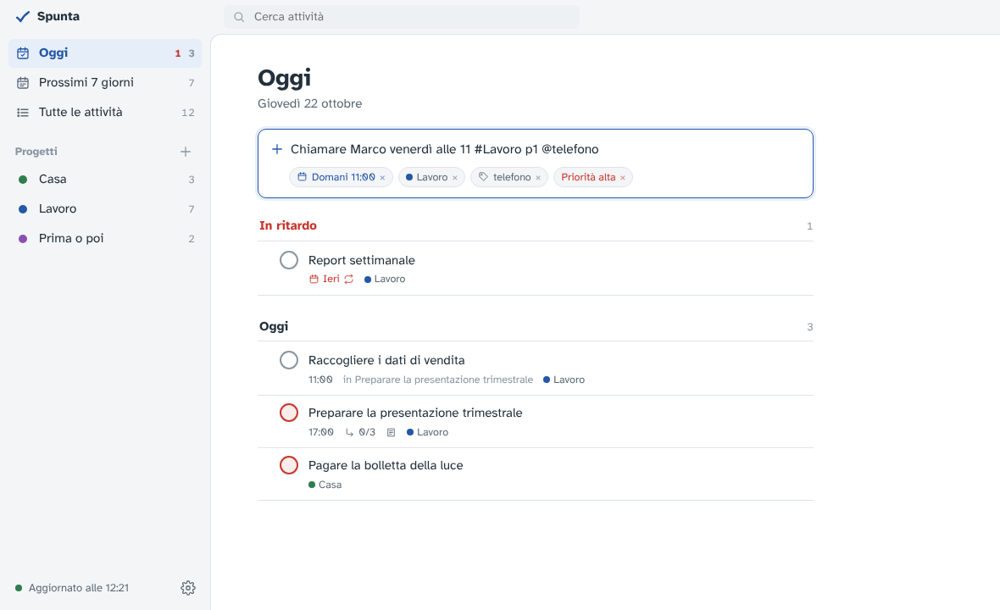
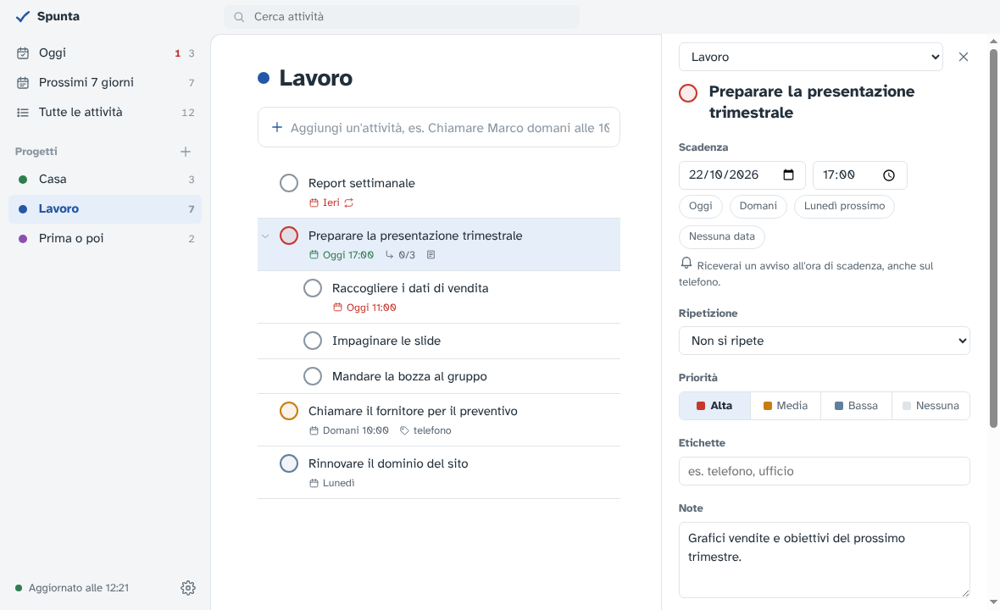
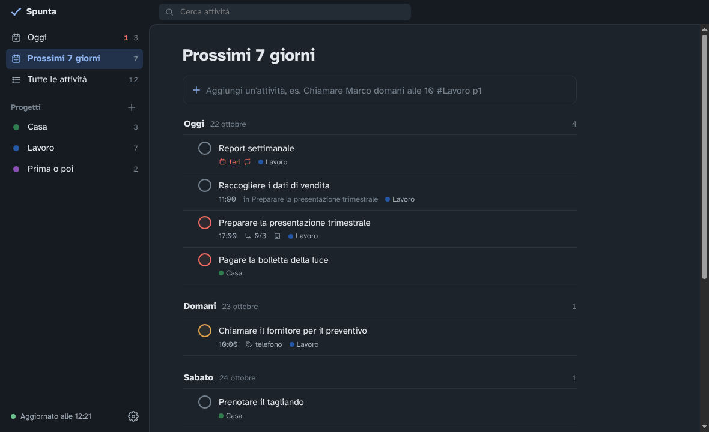

# Spunta

> [!WARNING]
> **Al primo avvio Windows mostra l'avviso "PC protetto".** Succede perché Spunta non ha una firma digitale, un certificato a pagamento che le piccole app gratuite di solito non hanno: non significa che contenga virus. Per avviarla clicca **Ulteriori informazioni**, poi **Esegui comunque**. Il codice è tutto qui, pubblico e verificabile, e i file da scaricare vengono creati direttamente da GitHub a partire da questo codice.

App per Windows e Linux in stile Todoist che usa **le attività del tuo Nextcloud**. Le stesse liste le vedi sul telefono con [Tasks.org](https://tasks.org) e [DAVx⁵](https://www.davx5.com): scrivi un'attività sul PC, la ritrovi su Android, e viceversa.

Gratuita, senza abbonamenti, senza limiti. I dati restano sul tuo server.



## Cosa fa

- **Inserimento rapido in italiano.** Scrivi `Chiamare Marco venerdì alle 11 #Lavoro p1 @telefono` e Spunta capisce data, ora, progetto, priorità ed etichetta.
- **Viste Oggi e Prossimi 7 giorni**, con le attività in ritardo in evidenza.
- **Progetti, priorità, sottoattività, note, etichette.**
- **Attività ricorrenti**: "ogni lunedì", "ogni giorno lavorativo", "ogni 2 settimane"…, anche con una fine ("fino al 30/11", "per 10 volte").
- **Attività senza data**, per le cose da fare "prima o poi".
- **Notifiche del sistema** all'ora di scadenza e riepilogo del mattino.
- **Funziona anche offline**: le modifiche partono quando torna la connessione.
- **Tema chiaro e scuro**, che segue quello del sistema.



## Di cosa hai bisogno

- Un PC con **Windows 10 o 11** oppure **Linux** (64 bit).
- Un **Nextcloud** con le attività (CalDAV): il tuo, oppure uno presso un fornitore. Dovrebbe funzionare con qualunque server CalDAV, ma è stato provato con Nextcloud.

## Installazione

Scarica l'ultima versione dalla pagina [Releases](../../releases).

### Windows

- **Spunta-Portatile-x.y.z.exe**: un solo file, non installa nulla. Comodo per provarla.
- **Spunta-Setup-x.y.z.exe**: installer classico, con icona nel menu Start e disinstallazione da Impostazioni.

Al primo avvio ricordati dell'avviso **"PC protetto"** descritto in cima a questa pagina: clicca **Ulteriori informazioni**, poi **Esegui comunque**.

### Linux

- **Spunta-x.y.z-x86_64.AppImage**: un solo file che funziona su quasi tutte le distribuzioni. Rendilo eseguibile (tasto destro → Proprietà → "Consenti l'esecuzione", oppure `chmod +x Spunta-*.AppImage`) e avvialo con un doppio clic.
- **spunta_x.y.z_amd64.deb**: pacchetto per Ubuntu, Linux Mint e Debian. Si installa con un doppio clic o con `sudo apt install ./spunta_*.deb`, e compare nel menu delle applicazioni.

Su Linux l'avviso "PC protetto" non c'è. Due cose da sapere:

- L'icona vicino all'orologio, che tiene Spunta attiva a finestra chiusa, compare su KDE, Cinnamon, XFCE e MATE. Su **GNOME** (Ubuntu standard) serve l'estensione "AppIndicator", di solito già presente in Ubuntu. Se l'icona non c'è, riaprire Spunta dal menu riporta la finestra.
- La scorciatoia `Ctrl+Alt+A` da qualunque programma funziona sulle sessioni X11; su Wayland il sistema potrebbe non permetterla.

### Collegamento a Nextcloud

1. In Nextcloud apri **Impostazioni personali → Sicurezza** e, in fondo, crea una **password per app** (chiamala per esempio "Spunta PC").
2. Avvia Spunta e inserisci l'indirizzo del server, il nome utente e la password per app.

Se sul server non ci sono ancora liste di attività, Spunta ti propone di crearne una.

**Versione portatile:** per ricevere le notifiche apri **Impostazioni → Attiva le notifiche**. Windows mostra le notifiche solo alle app con un collegamento nel menu Start, e Spunta lo crea solo se premi tu il pulsante.

### Sul telefono (Android)

Installa da [F-Droid](https://f-droid.org), dove sono gratuite:

1. **Tasks.org**: al primo avvio scegli "Continua senza sincronizzazione".
2. **DAVx⁵**: aggiungi un account scegliendo **Nextcloud**, accedi e, nella scheda CalDAV, attiva le liste di attività.

Le versioni del Play Store chiedono un pagamento per la sincronizzazione.

## Inserimento rapido

| Scrivi | Ottieni |
|---|---|
| `oggi`, `domani`, `dopodomani`, `venerdì`, `lunedì prossimo` | la data |
| `25/10`, `16 novembre`, `il 10`, `tra 3 giorni`, `fine mese` | la data |
| `alle 10`, `alle 15:30`, `stasera`, `domani pomeriggio` | l'ora (con promemoria) |
| `#Lavoro` | il progetto (se non esiste, viene creato) |
| `p1`, `p2`, `p3` | priorità alta, media, bassa |
| `@telefono` | un'etichetta |
| `ogni lunedì`, `ogni martedì e giovedì`, `ogni giorno lavorativo`, `ogni 2 settimane`, `ogni mese` | la ripetizione |
| dopo una ripetizione: `fino al 30/11`, `fino al 15 dicembre`, `fino a fine anno`, `per 10 volte` | quando smette di ripetersi |

Mentre scrivi, Spunta mostra sotto la casella cosa ha capito. Se una parola va lasciata nel titolo (per esempio "Leggere *Domani* è un altro giorno"), clicca la sua etichetta.

Nelle viste Oggi e Prossimi, un'attività senza data va a oggi; se indichi un progetto con `#`, resta senza data.

## Scorciatoie

| Tasto | Azione |
|---|---|
| `Ctrl+Alt+A` | nuova attività da qualunque programma |
| `Q` o `Ctrl+N` | nuova attività |
| `/` o `Ctrl+F` | cerca |
| `Alt+1`, `Alt+2`, `Alt+3` | Oggi, Prossimi, Tutte |
| `Esc` | chiude il pannello dei dettagli |
| `Canc` | elimina l'attività selezionata |



## Privacy

- Spunta parla solo con il **tuo** server. Nessuna statistica, nessun tracciamento, nessun servizio esterno.
- La password per app è salvata cifrata: su Windows con il sistema di protezione di Windows, su Linux con il portachiavi del desktop (GNOME Portachiavi o KWallet), se presente.
- Le attività sono tenute anche in una copia locale (in `%APPDATA%\Spunta` su Windows, `~/.config/Spunta` su Linux) per funzionare offline.

## Limiti noti

- Usata ogni giorno su Windows. Su Linux è provata su Ubuntu 24.04 (installazione, collegamento, attività, avvio automatico), ma non ancora in uso quotidiano su un PC desktop. Per Mac non ci sono pacchetti.
- Non si possono riordinare le attività trascinandole.
- Interfaccia solo in italiano.

## Per sviluppatori

Serve [Node.js](https://nodejs.org) 20 o successivo.

```bash
npm install
npm start            # avvia l'app
```

I test usano un piccolo server CalDAV di prova ([Radicale](https://radicale.org)):

```bash
pip install radicale
python3 test/server.py   # in un altro terminale
npm test
```

Per creare i file: `npm run dist` (Windows portatile), `npm run dist:installer` (Windows installer), `npm run dist:linux` (AppImage e .deb). Le Release su GitHub vengono create in automatico quando si pubblica un tag `v1.2.3`.

Struttura:

- `src/caldav.js`: dialogo con il server (CalDAV)
- `src/ical.js`: lettura e scrittura delle attività (formato iCalendar)
- `src/sync.js`: copia locale, coda delle modifiche offline, sincronizzazione
- `renderer/`: interfaccia; `renderer/quickadd.js` è l'interprete dell'inserimento rapido
- `main.js`: finestra, notifiche, icona vicino all'orologio, impostazioni

## Licenza

[MIT](LICENSE). Il carattere [Atkinson Hyperlegible](https://www.brailleinstitute.org/freefont/) è del Braille Institute of America e ha licenza [SIL OFL 1.1](renderer/fonts/OFL.txt).

Spunta è un progetto personale, offerto così com'è e senza garanzie. Le segnalazioni sono benvenute, ma non c'è un servizio di assistenza.
